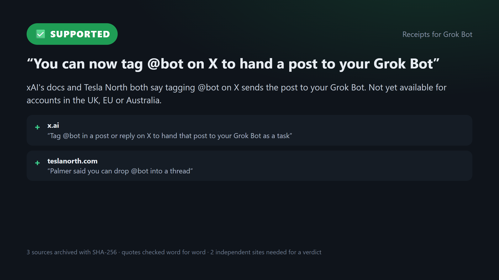

# Receipts for Grok Bot

**Tag @bot on a post, get the receipts.** A fact-check skill for [Grok Bot](https://docs.x.ai/grok-bot/overview) and a small command-line tool that does the part an AI shouldn't be trusted to do alone: archive the sources, check that every quote really is on the page, and refuse a confident verdict until two independent sites back it.



Watch it being built: the [42-second screen recording](https://github.com/Obiwayne/grokbot-receipts/releases/download/v0.1.0/receipts-build.mp4) (research to passing tests, sped up) and the [30-second ad](https://github.com/Obiwayne/grokbot-receipts/releases/download/v0.1.0/receipts-ad.mp4).

## Why

Asking "@grok is this true?" under a post has become how millions of people fact-check on X, and news outlets keep catching the confident wrong answers ([Al Jazeera](https://www.aljazeera.com/economy/2025/7/11/as-millions-adopt-grok-to-fact-check-misinformation-abounds), [BOOM](https://www.boomlive.in/explainers/grok-x-misinformation-fake-news-fact-checking-verification-28680)). Grok Bot can now be [tagged as @bot on X](https://docs.x.ai/grok-bot/tag-on-x) to hand a post to your own Bot, which has a real computer with a terminal. Receipts gives that Bot rules to work by:

- **Every source is archived** as Markdown with a SHA-256 hash and the time it was read, so the evidence survives a deleted post or an edited article.
- **Quotes are checked word for word** against the archived copy. A paraphrase or an invented quote is refused.
- **Two independent sites** are needed for *supported* or *contradicted*. Links from the same publisher count once, and the site the claim was posted on never counts as evidence for itself.
- **Any contradiction blocks a clean verdict.** It has to say *disputed*, or *unclear*.
- **Nothing is posted.** You get a report, a shareable card and a draft reply (checked against X's 280-character count) to approve yourself.

## Built from RepoQuarry

| Piece | Role |
|---|---|
| [Crawl4AI](https://repoquarry.dev/projects/crawl4ai) 0.9.5 | Opens each source in a headless browser and turns it into clean Markdown |
| [Grok Bot](https://repoquarry.dev/alternatives/grok-bot) | Finds the sources, judges each one and writes the verdict, following the skill |
| Python 3.10+ standard library | Archive, quote check, BM25 passage ranking, rules, report |

Without Crawl4AI installed, `receipts` falls back to a plain HTTP fetch, which works for most news pages but not for pages that need JavaScript.

## Install

```bash
pip install "grokbot-receipts[crawl4ai] @ git+https://github.com/Obiwayne/grokbot-receipts"
crawl4ai-setup
```

## Use it with Grok Bot

See [grok-bot/README.md](grok-bot/README.md). In short: paste [the skill](grok-bot/skills/receipts.md) into a Bot chat, save it, then reply to any post on X with `@bot receipts`. (Tagging isn't available yet for X accounts based in the UK, EU or Australia; paste the link into the Bot's chat instead.)

> The Grok Bot pack hasn't been run on a real Grok Bot plan yet. The command-line tool is fully tested.

## Use it yourself

```bash
receipts new "You can now tag @bot on X to hand a post to your Grok Bot" --post https://x.com/elonmusk/status/2112589019380875714
receipts add latest https://docs.x.ai/grok-bot/tag-on-x https://teslanorth.com/2026/10/20/grok-bot-x-dms-android-assistant/ https://help.x.com/en/using-x/about-bot
receipts stance latest 1 supports --quote "Tag @bot in a post or reply on X to hand that post to your Grok Bot as a task"
receipts verdict latest supported --why "xAI docs say so"
#  receipts: Can't say supported yet: it needs quotes from 2 independent sites that support the claim (have 1: x.ai).
receipts stance latest 2 supports --quote "Palmer said you can drop @bot into a thread"
receipts check latest
receipts verdict latest supported --why "xAI's docs and Tesla North both say tagging @bot on X sends the post to your Grok Bot. Not yet available for accounts in the UK, EU or Australia."
```

Each case lives in its own folder (`$RECEIPTS_HOME`, default `./receipts-cases`):

```
2026-10-22-you-can-now-tag-bot-on/
  case.json        claim, sources, stances, verdict
  sources/         each page as archived Markdown (01-x.ai.md, 02-teslanorth.com.md, ...)
  report.md        sources table, quotes, hashes, best-matching passages
  card.html        1200x675 verdict card (scripts/card_png.py renders it to PNG)
  reply.txt        draft reply for X, within 280 characters
```

Add `--json` to any command for machine-readable output.

| Command | Does |
|---|---|
| `new "<claim>" [--post URL]` | Opens a case |
| `add <case> URL...` | Fetches, archives and ranks passages for each source |
| `stance <case> <n> supports\|contradicts\|context [--quote "..."]` | Records what a source says; the quote must be on the archived page |
| `check <case>` | Lists which verdicts the evidence allows |
| `verdict <case> <label> --why "..."` | Gives the verdict and writes report, card and reply |
| `show`, `list`, `report` | Read cases back |

`<case>` can be `latest`.

## Tests

```bash
pip install -e ".[crawl4ai,test]"
pytest -v
```

14 tests: the rules, the quote check, site grouping, passage ranking, X's character count, and four full cases through the CLI against local stand-in sites (a post, a newspaper, a council page, a blog that disagrees), plus one real Crawl4AI browser fetch. CI runs them on Python 3.10 and 3.13, with and without Crawl4AI.

## Docs

- [How it works](docs/how-it-works.md)
- [Build log](BUILD_LOG.md): how this was built and what was checked

## Credits

This product includes software developed by UncleCode (https://x.com/unclecode) as part of the Crawl4AI project (https://github.com/unclecode/crawl4ai).

MIT licence. Found on [RepoQuarry](https://repoquarry.dev).
